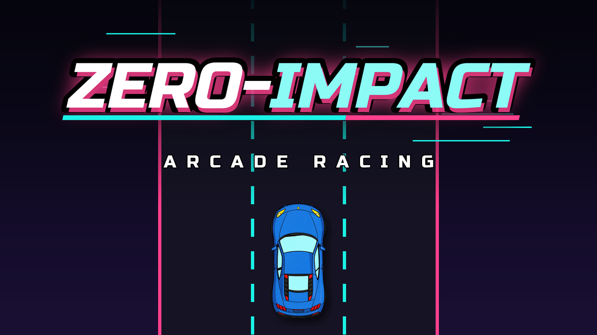

# ⚡ ZERO-IMPACT

<p align="center">
  
</p>

<p align="center">
  <strong>Jogo de corrida arcade 2D retro-futurista: desvie do tráfego intenso, utilize habilidades especiais, sintonize rádios synthwave e dispute o topo do ranking global.</strong>
</p>

<p align="center">
  
  
  
  
</p>

---

## 📖 Sobre o Jogo

**ZERO-IMPACT** é um jogo arcade frenético de corrida vertical em 2D desenvolvido na engine **Godot 4**. Inspirado nos clássicos de desvio de tráfego dos anos 80 e 90 com uma roupagem *cyberpunk / synthwave*, o objetivo é sobreviver o máximo possível em rodovias cheias de perigos, coletando moedas, acumulando combos com desvios no limite (**Raspão**) e desbloqueando novos veículos e melhorias permanentes.

O projeto é 100% autossuficiente: todo o visual vetorial dos carros e os efeitos sonoros procedurais são gerados por scripts internos sem dependências de pacotes externos pagos.

---

## ✨ Principais Funcionalidades

### 🏎️ Garagem de Veículos
Uma coleção de veículos com atributos e mecânicas exclusivas:
- **Equilibrado:** O carro padrão para dominar as pistas.
- **Turbo:** Troca de faixas com agilidade imediata.
- **Blindado:** Inicia a corrida com 3 segundos de escudo protetor.
- **Pickup:** Estrutura pesada que suporta 1 colisão extra antes do Game Over.
- **Muscle:** Turbinado financeiramente (+50% de moedas coletadas).
- **Esportivo:** Possui ímã integrado e bônus de +25% de pontuação.
- **F1:** Agilidade extrema nas curvas e +50% de pontuação.
- **Roadster (SpaceX Concept):** Inspirado no novo conceito Tesla/Cybercab. Equipado com a habilidade ativa **SpaceX Jump** — jatos de gás comprimido sob o chassi lançam o carro para o alto a cada 15 segundos, sobrevoando tráfego e obstáculos com invulnerabilidade temporária.
- **ZERO:** O carro definitivo de 10.000 moedas com escudo, vida extra, ímã, moedas em dobro e +50% de pontuação.

### 🛣️ Dinâmica de Trânsito & Obstáculos Justos
- **Passabilidade Garantida:** Algoritmo de corredor seguro que calcula o fluxo de veículos e garante que nunca haja um bloqueio triplo inevitável.
- **IA de Ultrapassagem:** Carros mais rápidos dão seta e mudam de faixa para não bater em veículos lentos à frente.
- **Inimigos & Rivais:** Veículos velozes sobem a rodovia com avisos de proximidade (`▲ RIVAL ▲`) no rodapé da tela.
- **Veículos de Emergência:** Viaturas policiais e ambulâncias com giroflex luminosos e sirenes dedicadas.
- **Zonas em Obras:** Trechos temporários com cones iluminados e sinalizadores piscantes.

### 📻 Áudio Procedural & Rádio Synthwave
- Sistema de áudio 100% gerado por código procedural em Python e sintetizado em ondas puras.
- **Efeito Doppler Realista:** Tom sonoro que se altera dinamicamente conforme os carros se aproximam e cruzam o jogador em alta velocidade.
- **Rádio no Painel:** Alterne entre diferentes estações synthwave durante a corrida (*Synth Wave*, *Cyber Rush*, *Chill Drive*).
- **Buzina Dinâmica:** Efeito sonoro imediato no trânsito.

### 🏆 Modos de Jogo & Conquistas
- **Carreira Solo:** Suba de patente de **Bronze** até **Lenda** acumulando quilometragem e batendo recordes.
- **Modo por Turnos Local:** Competição no mesmo dispositivo para até 8 jogadores com placar e desempate por pontos.
- **Catálogo de Conquistas:** Sistema de *achievements* com notificações (toasts) na tela e galeria de troféus.
- **Ranking Global (Supabase):** Envio automático de pontuação para o placar mundial.
- **Oficina:** Aumente permanentemente a duração de Escudos, Nitros, Câmera Lenta e Ímãs.

---

## 🎮 Controles

| Ação | Teclado | Gamepad / Controle | Touch / Mobile |
| :--- | :--- | :--- | :--- |
| **Trocar de Faixa** | `←` / `→` ou `A` / `D` | D-Pad ou Analógico Esquerdo | Deslizar dedo ou tocar nos lados |
| **Pulo SpaceX (Roadster)** | `W` ou `↑` | Botão `A` / Cruz | Botão de pulo no HUD |
| **Buzina** | `Espaço` ou `H` | Botões `LB` / `RB` (L1 / R1) | — |
| **Mudar Rádio** | `R` | Botão `X` / Quadrado | Botão de rádio no HUD |
| **Pausa / Voltar** | `Esc` | Botão `Start` / Menu | Botão de pausa no topo |
| **Tela Cheia** | `F11` | — | — |

---

## 📁 Estrutura do Projeto

```text
Projeto_PI/
├── project.godot            # Configurações do motor Godot
├── export_presets.cfg       # Perfis de exportação (Web, iOS, etc.)
│
├── scenes/                  # Cenas do jogo (.tscn)
│   ├── Menu.tscn            # Menu principal animado
│   ├── Game.tscn            # Cena principal de corrida
│   ├── Garage.tscn          # Garagem e seleção de veículos
│   ├── Upgrades.tscn        # Oficina de melhorias
│   ├── Ranking.tscn         # Telas de recordes locais e mundiais
│   ├── Achievements.tscn   # Galeria de conquistas
│   └── GameOver.tscn        # Tela de final de corrida
│
├── scripts/                 # Lógica do jogo em GDScript
│   ├── GameManager.gd       # Singleton: estado da corrida, biomas, carros
│   ├── AudioManager.gd      # Singleton: rádio, efeitos sonoros, efeito doppler
│   ├── SaveManager.gd       # Singleton: salvamento atômico em JSON
│   ├── OnlineRanking.gd     # Singleton: integração REST com Supabase
│   ├── Player.gd            # Física, faixas e habilidade de pulo do jogador
│   ├── Spawner.gd           # Algoritmo de geração de tráfego justo
│   ├── Traffic.gd           # IA dos veículos (ultrapassagem, seta, tipos)
│   ├── World.gd             # Pista com perspectiva, curvas e iluminação
│   ├── Weather.gd           # Efeitos climáticos (chuva, neve, tempestade)
│   ├── Lighting.gd          # Shaders de transição dia/noite e faróis
│   └── Achievements.gd      # Catálogo e lógica de desbloqueio de troféus
│
├── assets/                  # Recursos de mídia
│   ├── audio/               # Músicas e efeitos sonoros (.wav)
│   ├── images/cars/         # Sprites vetoriais dos carros (.svg)
│   ├── icons/               # Ícones de aplicação para todas as plataformas
│   └── fonts/               # Tipografia arcade (Russo One)
│
└── tools/                   # Scripts auxiliares em Python
    ├── gerar_sons.py        # Sintetizador procedural de áudio e músicas
    └── gerar_carros.py      # Gerador procedural de arte vetorial dos veículos
```

---

## 🚀 Como Executar

### Pré-requisitos
- **[Godot Engine 4.3+](https://godotengine.org/download)** instalado.

### 1. Rodando no Computador (Editor Godot)
1. Abra o **Godot Engine**.
2. Clique em **Importar** (*Import*) e selecione o arquivo `project.godot` deste repositório.
3. Clique em **Importar e Editar**.
4. Pressione `F5` para iniciar o jogo.

### 2. Rodando no Navegador (Web)
O projeto conta com predefinição configurada para HTML5/WebAssembly:
```bash
# Exportar para Web via linha de comando
godot --headless --export-release "Web" build_web/index.html
```

### 3. Rodando no iPhone (iOS via Xcode)
1. No Godot, abra **Projeto > Exportar...** e selecione o preset **iOS**.
2. Clique em **Exportar Projeto...** e aponte para `build_ios/zeroimpact.xcodeproj`.
3. Abra o arquivo `zeroimpact.xcodeproj` no **Xcode**.
4. Na aba **Signing & Capabilities**, selecione seu **Personal Team** (Apple ID gratuito).
5. Na aba **General**, mantenha a orientação como **Portrait** (Vertical).
6. Conecte seu iPhone via cabo, selecione-o no topo do Xcode e aperte `Cmd + R` (Play ▶️).

---

## 🌐 Configuração do Ranking Online (Supabase)

O jogo utiliza o Supabase para sincronizar as melhores pontuações globais:

1. Crie uma conta gratuita em [supabase.com](https://supabase.com).
2. No painel do seu projeto, acesse o **SQL Editor** e execute:
   ```sql
   create table scores (
     id text primary key,
     name text not null check (char_length(name) between 1 and 12),
     score int not null check (score between 0 and 10000000),
     km real not null,
     car text
   );
   alter table scores enable row level security;
   create policy "ler" on scores for select using (true);
   create policy "inserir" on scores for insert with check (true);
   create policy "atualizar" on scores for update using (true);
   ```
3. Em **Project Settings > API**, copie a **Project URL** e a chave pública anon (`anon / public`).
4. Cole as chaves em [`scripts/OnlineRanking.gd`](scripts/OnlineRanking.gd):
   ```gdscript
   const SUPABASE_URL := "https://SEU_PROJETO.supabase.co"
   const SUPABASE_KEY := "SUA_CHAVE_PUBLICA"
   ```

---

## 🛠️ Tecnologias Utilizadas

- **Engine:** Godot 4 (GDScript, Shaders 2D e CanvasItem)
- **Áudio & Assets:** Python 3, NumPy, Sips (Processamento de Imagens e Síntese Sonora)
- **Banco de Dados:** Supabase (PostgreSQL + REST API)
- **Deploy:** macOS, Xcode, WebAssembly

---

<p align="center">
  Desenvolvido com foco em performance, fluidez e jogabilidade arcade.
</p>
